# Skill Dependency Map

このドキュメントは、`skills/internal/` と手管理 plugin の skill 同士にある明示的な依存関係を整理するためのマップです。

ここでの依存は、`SKILL.md` の本文や description に「併用する」「使う」「参照する」と明記されている関係を対象にします。似た目的を持つだけの関係や、エージェントロール上の暗黙の関係は含めません。

「この目的なら別 skill を優先する」という関係は、実行時の依存ではなくルーティングとして別に整理します。

## 全体図

```text
skills
├── workflow
│   └── cmd-create-pr
│   │   ├── cmd-commit
│   │   ├── role-reviewer
│   │   └── format-pr-description
├── role
│   ├── finder plugin (`plugins/finder/skills/`)
│   │   ├── role-bug-finder -> issue-finder-playbook, role-bug-finder-playbook
│   │   ├── role-maintenance-finder -> issue-finder-playbook, role-maintenance-finder-playbook
│   │   ├── role-feature-finder -> issue-finder-playbook, role-feature-finder-playbook
│   │   ├── role-vulnerability-finder -> issue-finder-playbook, role-vulnerability-finder-playbook
│   │   └── role-documentation-finder -> issue-finder-playbook, role-documentation-finder-playbook
│   ├── issue-finder-playbook
│   │   ├── modification-design
│   │   └── lego-programming
│   ├── roles plugin (`plugins/roles/skills/`)
│   │   ├── role-documenter-playbook -> documenting
│   │   ├── role-refactor-playbook -> modification-design
│   │   └── role-implementer-playbook -> role-advisor
└── code work
    ├── lego-programming
    │   ├── code-css
    │   └── component-design
    ├── modification-design
    │   └── lego-programming
    └── review-test-code
        ├── format-test-cases
        └── code-test
```

## ワークフロー系

| Skill | 依存先 | 関係 |
|---|---|---|
| `cmd-create-pr` | `cmd-commit` | 未コミット変更や High 指摘対応後の追加差分を commit するときに使う。 |
| `cmd-create-pr` | `role-reviewer` | PR 作成・更新前のレビューゲートとして使う。 |
| `cmd-create-pr` | `format-pr-description` | PR description を作るときに使う。 |

## ロール系

| Skill | 依存先 | 関係 |
|---|---|---|
| `role-bug-finder` | `issue-finder-playbook`, `role-bug-finder-playbook` | Issue Finder agent へ共通調査 contract と不具合判定基準を指定する。 |
| `role-maintenance-finder` | `issue-finder-playbook`, `role-maintenance-finder-playbook` | Issue Finder agent へ共通調査 contract と保守性判定基準を指定する。 |
| `role-feature-finder` | `issue-finder-playbook`, `role-feature-finder-playbook` | Issue Finder agent へ共通調査 contract と機能提案基準を指定する。 |
| `role-vulnerability-finder` | `issue-finder-playbook`, `role-vulnerability-finder-playbook` | Issue Finder agent へ共通調査 contract と脆弱性判定基準を指定する。 |
| `role-documentation-finder` | `issue-finder-playbook`, `role-documentation-finder-playbook` | Issue Finder agent へ共通調査 contract と文書課題判定基準を指定する。 |
| `issue-finder-playbook` | `modification-design` | 変更方針を確定できる課題へ変更後設計を埋め込むときに使う。 |
| `issue-finder-playbook` | `lego-programming` | Modification Design の責務境界を判断するときに併用する。 |
| `role-documenter-playbook` | `documenting` | Documenter agent が文書の配置、優先順位、構成、記述スタイルを判断するときに使う。 |
| `role-refactor-playbook` | `modification-design` | Refactor agent が変更後の責務、境界、依存方向を設計するときに併用する。 |
| `role-implementer-playbook` | `role-advisor` | 実装方針や技術選定で判断が必要なときに指示を仰ぐ。 |

## コード作業系

| Skill | 依存先 | 関係 |
|---|---|---|
| `lego-programming` | `code-css` | CSS 固有の実装判断が必要な場合に併用する。 |
| `lego-programming` | `component-design` | React / Next.js / TypeScript UI の大きな分割で、先に画面構成やコンポーネント境界を整理するときに併用する。 |
| `modification-design` | `lego-programming` | 変更対象を高凝集・疎結合なレゴとして整理し、責務と依存方向を定義するために併用する。 |
| `review-test-code` | `format-test-cases` | PR のテストケースを、条件、入力、操作、実際のアサーション、根拠として整理するために使う。 |
| `review-test-code` | `code-test` | テストの観測範囲、モック、再現性、境界値を評価するときに併用する。 |

## 優先・ルーティング関係

次の関係は、ある skill が別 skill を内部で使うという意味ではありません。ユーザーの目的に合わせて、どちらの skill を先に選ぶべきかを示します。

| 起点 | 優先先 | 条件 |
|---|---|---|
| `format-tracer` | `code-tracer` | 整形する経路の追加調査が必要な場合。 |
| `modification-design` | `role-planner` | 変更後の構造ではなく、実装手順、タスクリスト、Definition of Done が主目的の場合。 |
| `modification-design` | `component-design` | React UI の詳細な component tree、props、hooks、状態管理が主目的の場合。 |

## Mermaid 図

```mermaid
graph TD
    role_bug_finder["role-bug-finder"] --> issue_finder_playbook["issue-finder-playbook"]
    role_bug_finder --> role_bug_finder_playbook["role-bug-finder-playbook"]
    role_maintenance_finder["role-maintenance-finder"] --> issue_finder_playbook
    role_maintenance_finder --> role_maintenance_finder_playbook["role-maintenance-finder-playbook"]
    role_feature_finder["role-feature-finder"] --> issue_finder_playbook
    role_feature_finder --> role_feature_finder_playbook["role-feature-finder-playbook"]
    role_vulnerability_finder["role-vulnerability-finder"] --> issue_finder_playbook
    role_vulnerability_finder --> role_vulnerability_finder_playbook["role-vulnerability-finder-playbook"]
    role_documentation_finder["role-documentation-finder"] --> issue_finder_playbook
    role_documentation_finder --> role_documentation_finder_playbook["role-documentation-finder-playbook"]
    issue_finder_playbook --> modification_design
    issue_finder_playbook --> lego_programming

    cmd_create_pr["cmd-create-pr"] --> cmd_commit["cmd-commit"]
    cmd_create_pr --> role_reviewer["role-reviewer"]
    cmd_create_pr --> format_pr_description["format-pr-description"]

    role_documenter_playbook["role-documenter-playbook"] --> documenting
    role_refactor_playbook["role-refactor-playbook"] --> modification_design["modification-design"]
    role_refactor_playbook --> role_planner["role-planner"]
    role_refactor_playbook --> role_implementer["role-implementer"]
    role_refactor_playbook --> role_reviewer
    role_refactor_playbook --> role_advisor["role-advisor"]
    role_implementer_playbook["role-implementer-playbook"] --> role_advisor

    lego_programming --> code_css["code-css"]
    lego_programming --> component_design["component-design"]

    modification_design["modification-design"] --> lego_programming

    review_test_code["review-test-code"] --> format_test_cases["format-test-cases"]
    review_test_code --> code_test["code-test"]

```



## 更新ルール

skill を追加または更新したときに、他 skill を明示的に参照する文を増やした場合は、このドキュメントも更新します。

更新時は次を確認します。

- `SKILL.md` に `$skill-name`、`` `skill-name` ``、または plain text で依存先が書かれているか。
- 依存が「必ず使う」「必要に応じて併用」「優先・ルーティング」のどれに近いか。
- 優先・ルーティング関係を実行時依存としてツリー図や Mermaid 図に混ぜていないか。
- ツリー図、表、Mermaid 図のすべてに同じ関係が載っているか。
- 外部 skill への依存は `(external)` と明記しているか。
