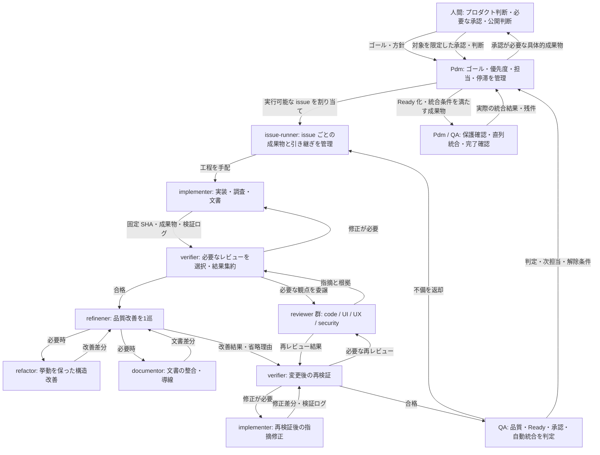

# Factory

ゴールから GitHub Issues の計画・優先順位付け、最大5件の並行実行、レビュー、品質改善、QA、条件付きマージまでを進める plugin です。人間はプロダクト方針の判断と、承認が必要な成果物の確認を担当します。

## 導入と前提

導入する plugin は `factory@agents-docs` です。Codex / Claude での marketplace 登録と導入方法は [plugin 配布ガイド](https://github.com/version-1/agents-docs/blob/main/docs/plugin-distribution.md) を参照してください。`agent-orchestration` や `skill-factory` の追加は不要です。

実行先には GitHub リポジトリ、issue・PR を扱う権限、Git worktree を作れる作業環境、agent を委譲できる実行環境が必要です。実行先の `AGENTS.md`、モデル指定、検証コマンド、Git / GitHub 操作規則に従います。plugin の導入だけで実行権限やマージ権限が付与されることはありません。

factory はエージェント向けの手順を提供します。常駐サービスや webhook は同梱していません。1 issue に1人の issue-runner を割り当て、issue 間では最大5件を並行実行します。verifier、refinener、QA は issue ごと・工程ごとに専任担当を起動し、同一 issue 内では実装、検証、品質改善、再検証、QA の順に進めます。工程の完了後は引き継ぎを残して担当を終了できるため、レビュー担当も含む実環境の agent 上限が小さい場合は空きを待って再開します。verifier が依頼する独立したレビューは並行できます。

## ロールの関係全体図

以下は責務と引き継ぎの関係です。同時に全ロールを起動する意味ではなく、実環境の枠に合わせて担当を起動します。QA からの修正依頼も issue-runner が受けて、必要な工程へ戻します。



PR の merge 承認と配布公開の承認は別に扱います。品質不合格や保護不足は承認で免除しません。追加指示は Pdm が取り込み、実行中の担当へ反映します。常駐監視は行わず、ユーザー入力・担当イベント・新規割り当て前・定めた確認時点に確認します。詳しい責務と役割ごとの通信は [役割契約](skills/factory/references/roles.md)、工程間の記録と判定は [引き継ぎと QA](skills/factory/references/handoff.md) を参照してください。

## ゴールを渡す

対象リポジトリで、plugin を有効にしたエージェントに指示します。

```text
/factory 音声ファイルの取り込みで、プランの時間上限を超えた場合に理由を表示して登録を拒否できるようにする
```

Pdm が現状と既存 issue・PR を確認し、ゴールの管理 issue に達成条件・対象外・作業 issue を記録します。計画の承認は挟まず、実行可能な issue を優先順位順に進めます。曖昧さが達成条件やプロダクト判断を左右するときは、推奨案を添えて確認します。

ゴールは、完了を確認できる範囲で伝えてください。既存方針内の仕様具体化や必要な issue の追加は Pdm に任せられます。ターゲット・料金・初期スコープ・期限などの方針変更は人間へ戻します。

同じゴールを再度渡した場合は、既存の管理 issue と実際の PR・作業状況を照合して再開します。対象の管理 issue URL を添えると、再開先を特定しやすくなります。

## 外から issue を追加する

実行先と同じリポジトリで GitHub Issue を作成し、次の2点を設定します。既存 issue に後から設定しても構いません。

1. `factory` ラベルを付ける。ラベルがなければ、リポジトリの管理者が用意してください。
2. 本文に対象ゴールの管理 issue を `Factory goal: <完全な URL>` として1件指定する。

本文の例です。URL は実際の管理 issue のものに置き換えてください。

```markdown
Factory goal: https://github.com/OWNER/REPO/issues/123

## 依頼内容
上限を超えたファイルを取り込もうとしたとき、許容時間とファイルの長さを表示してほしい。

## 期待する結果
- 登録を拒否した理由が分かる。
- 拒否後も既存のカードと音声が維持される。
```

Pdm は開始・再開時と、新しい issue の割り当て前に候補を確認します。採用した issue は受け入れ条件・依存関係・変更範囲・優先度を整理してキューへ追加し、管理 issue に判断を記録します。追加した順の実行ではなく、既存の仕事と合わせて優先順位を決めます。

ラベルとリンクは取り込み候補の指定です。ゴール外の依頼は提案として残し、方針変更が必要ならその判断だけを人間に戻します。重複した仕事は二重実行せず、既存 issue に関連付けます。停止中は即時に取り込まず、再開時に確認します。完了したゴールを追加依頼だけで再開・拡張することもありません。

## Issue の分類

管理 issue・作業 issue には `factory` ラベルが必須です。種類は `type:` を原則1つ、領域は `area:` を必要に応じて付け、同義の既存ラベルを再利用します。ラベルなしの既存 issue は自動で処理対象にせず、ユーザーが指定した場合に取り込みます。

Projects は状態・優先度・GitHub 上の担当、Milestone はリリースや期限のある達成目標に使います。どちらも既存設定またはユーザー指定がある場合に使用し、未設定なら構成を提案して作成前に確認します。Projects 未使用時は状態・優先度・担当を本文で管理します。

Relations で管理 issue と作業 issue の親子関係、blocked by / blocking で依存関係を設定します。必須ラベルや Relations を設定できなければ実装開始を保留します。`factory` が解除された場合は対象の処理と自動マージを止め、途中状態を保存します。詳細は [Issue の分類と関連付け](skills/factory/references/issue-classification.md) を参照してください。

## 承認する

```text
/factory approve
```

提示された承認待ちのうち、会話上の対象が一意な1件だけを承認します。複数あって特定できない場合は確認します。どの項目かを自然言語で指定することもできます。PR の承認は提示された変更内容に適用され、重要な変更があれば再承認になります。

課金・認証・データ削除／移行・外部送信・公開設定・既存プロダクト方針の変更を含む PR は人間承認の対象です。承認待ちと、それに依存する issue だけを保留し、独立した issue は進めます。

承認によって品質条件を免除することはできません。必須 CI、必要なレビュー、受け入れ条件を満たし、Medium 以上の未解決指摘がないことが必要です。自動マージには、検証済み head と最新 base に対する保護を確認できることも求めます。

## 停止・再開・方針変更

専用の `skip` / `next` コマンドはありません。自然言語で指示します。

```text
factory を停止して、途中の状態を記録して
管理 issue https://github.com/OWNER/REPO/issues/123 の factory を再開して
この承認待ちの変更は却下して、影響する計画を見直して
```

停止時は新規の割り当てを止め、実行中の担当にも中断を伝え、途中状態を記録します。再開時に既存 issue・PR・worktree・SHA と外部追加の候補を確認します。担当を再起動する場合も、受け入れ条件、成果物、検証結果、未解決指摘、再試行回数、次の工程または保留理由を引き継ぎます。

## 進捗と完了を確認する

ゴールの管理 issue が進捗の入口です。作業 issue、依存関係、成果物、承認待ち、保留理由を確認できます。

通常は、実装 → 必要なレビューと修正 → 挙動を維持した品質改善 → 再検証 → QA と進みます。同じ原因で連続3回改善しない issue は保留し、試した対応と解除条件を記録します。調査レポートなど PR を作らない issue も、独立した検証と QA を通れば完了にできます。

各工程の引き継ぎには、次担当・固定 SHA・受入条件・検証ログ・残件・承認要否を残します。依頼の送信だけで開始済みとせず、idle の担当は明示的に起動して開始を確認します。レビュー枠を確保し、新規 PR より既存成果物の検証・QA・Ready 化を優先します。

QA は品質、Ready 化、merge の人間承認、配布公開の人間承認、自動統合可否を別々に判定します。完成した Draft は Ready 化へ進めますが、未完了の実装や必須 native 検証が残れば Draft を維持します。保護不足は別の blocker として記録し、強制マージしません。

達成条件をすべて満たすと停止し、成果物と検証根拠を報告します。全件が承認待ち・保留の場合は、必要な入力と再開点を報告します。セッション終了後の自動監視や継続実行は行いません。

## 振り返りを次の実行に反映する

`factory-feedback` は共通 factory スキルの問題・改善案を整理し、`version-1/agents-docs` に GitHub Issue を作成します。期待と実際の違い、根拠、改善案、受け入れ条件をまとめ、既存 Issue との重複を確認します。利用先プロジェクトの非公開情報は送信内容に含めません。

`factory-recap` は利用先プロジェクト固有の判断基準・検証方法・運用上の知見を、project スコープのガイドライン skill に保存します。既存 skill があれば更新し、新規は `.agents/skills/factory-project-guidelines/SKILL.md` を既定とします。既存の配置規約に従う場合は AGENTS.md / CLAUDE.md に入口を用意します。factory は開始・再開時にガイドラインを読みます。

```text
/factory-feedback レビューで同じ指摘が繰り返された原因を factory の改善 Issue にして
/factory-recap 今回の振り返りから、このプロジェクトの factory 運用ガイドラインを更新して
```

feedback は改善提案の Issue 作成、recap はローカル skill の作成・更新までを行います。実装や factory の再開は別途指示してください。

## エージェント向けの詳細

- [factory の入口と実行条件](skills/factory/SKILL.md)
- [共通 factory への改善 feedback](skills/factory-feedback/SKILL.md)
- [プロジェクトの運用ガイドラインの作成・更新](skills/factory-recap/SKILL.md)
- [役割ごとの責務](skills/factory/references/roles.md)
- [進捗・承認・マージの契約](skills/factory/references/state.md)
- [外部 issue の取り込み手順](skills/factory/references/intake.md)
- [Issue の分類と関連付け](skills/factory/references/issue-classification.md)
- [工程の引き継ぎ・停滞検知・QA 判定](skills/factory/references/handoff.md)
- [引き継ぎと QA の検証シナリオ](skills/factory/evals/handoff-scenarios.md)
