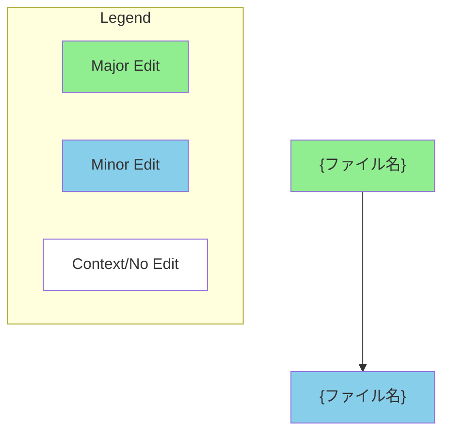

## 目的
GitHub Pull Request の description を、定義済みテンプレートに基づいて  
**一貫した形式で自動生成**する。

---

## Inputs
- `PR_NUMBER`（または参照可能な PR の diff / commit 情報）

---

## Outputs
- 対象 PR の description を、変更概要、主な変更点、実装内容、動作確認、レビュアー向けチェックリスト、必要に応じた Mermaid Diagram を含む形式で更新する。
---

## PR Description Template (Canonical)

```markdown
# {変更内容のタイトル}

## Summary
{変更の背景と概要を簡潔に記載}

**主な変更点:**
- {変更点1}
- {変更点2}
- {変更点3}

## やったこと
- {実装内容}
- {修正内容}
- {テスト追加・変更}

## 動作確認
- [ ] {確認項目1}
- [ ] {確認項目2}
- [ ] {確認項目3}

## レビュー & 動作確認 チェックリスト
- [ ] **{重要項目1}** - {説明}
- [ ] **{重要項目2}** - {説明}
- [ ] **{重要項目3}** - {説明}

**推奨テスト計画:**
1. {手順1}
2. {手順2}
3. {手順3}

## その他気になることや相談ごと
{特になければ空欄}

---

### Diagram (Optional)


Notes
{特記事項やコメント}

## 実行手順

### 1. PR情報の取得と分析
```bash
gh pr view {PR_NUMBER} --repo your/repository
gh pr diff {PR_NUMBER} --repo your/repository
gh pr view {PR_NUMBER} --repo your/repository --json commits
```

### 2. Description更新
```bash
echo "上記テンプレートの内容" > pr_description.md
gh pr edit {PR_NUMBER} --repo your/repository --body-file pr_description.md
```
### テンプレート記入ガイド

#### 必須項目
- タイトル、Summary、主な変更点、やったこと、動作確認を、変更内容と確認項目に即して記載する。

#### 推奨項目
- レビュアー向けチェックリスト、推奨テスト計画、変更の複雑さに応じた Mermaid Diagram。

#### 省略可能項目
- チケットへのリンク、その他気になることや相談ごと（特になければ空欄）。

#### 注意事項
- 依頼者情報は正確なGitHubユーザー名を記載する
